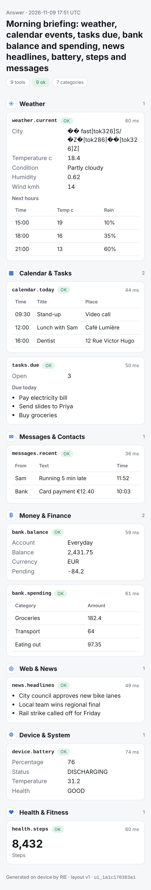
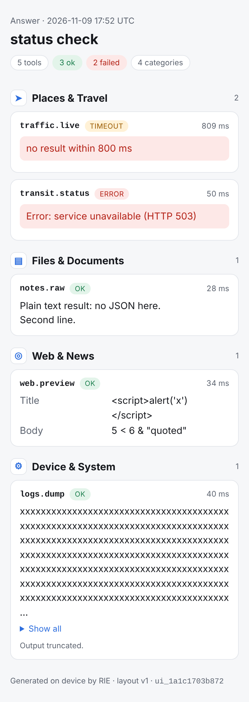

# Ask the phone: headless tools → one categorized page

`POST /v1/ask` turns a question into a finished, consistently formatted answer page:

1. **Select.** The server picks every *relevant* headless tool: those sharing a
   meaningful word with the question (a tool-name match counts double), up to
   `max_tools` (default 6). You can also pass `"tools": [...]` explicitly or
   `"all": true`. A question unrelated to every tool gets an empty-state page instead
   of a random tool.
2. **Fill.** For each selected tool, the model writes the arguments under the grammar
   constraint, so they always match the tool's JSON schema (types, enums, required
   fields). Learned notes about the tool's past failures are included in the prompt.
   If the arguments cannot be prepared (for example, the context is too small), the tool
   is **not** run and its card says why.
3. **Run.** The tools run in parallel, without holding the model. Each tool has a
   timeout, output is capped at 256 KB, and errors, timeouts and odd output become
   cards instead of failures.
4. **Learn.** Each outcome updates the tool book (limitations and expectations) and the
   on-device memory (with `--memory DIR`).
5. **Render.** One deterministic renderer produces the page as HTML (`/ui/ID`), as a
   JSON spec (`/ui/ID.json`, for native Android/iOS views) and as Markdown (`/ui/ID.md`,
   for chat bubbles and notifications).

```bash
rie-server -m model.gguf --headless-tools examples/phone-tools/termux.json --memory ~/.rie
curl localhost:8080/v1/ask -d '{"question": "Morning briefing: weather, calendar, bank balance, battery"}'
# → {"id": "ui_…", "ui_url": "/ui/ui_…", "ui": {...spec...}, "markdown": "..."}
```

## Same style every time (layout v1)

* **Fixed categories, in a fixed order:** Weather · Calendar & Tasks · Messages &
  Contacts · Money & Finance · Places & Travel · Files & Documents · Web & News · Device
  & System · Health & Fitness · Other. A tool goes in the category its manifest declares,
  otherwise in the best exact keyword match for its name and description.
* **Cards** are sorted by tool name. Each shows a status badge (`ok` / `error` /
  `timeout`) and its duration.
* **Six item types:** metric, fields, table, list, text, error. Every tool output is
  normalized into them:
  * a number becomes a metric;
  * an object of scalars becomes fields, in the tool's own key order;
  * an array of objects becomes a table (at most 6 columns and 20 rows, "+N more");
  * an array of scalars becomes a list;
  * plain text becomes text (long text is folded behind "Show all");
  * `{"error": …}` becomes an error.
* **One formatting rule per value type:**
  * integers get thousands separators (`8,432`);
  * decimals get at most 2 places (`2,431.75`);
  * booleans become Yes/No, and null becomes `—`;
  * keys are humanized (`annualRate` → "Annual rate");
  * times are shown as `YYYY-MM-DD HH:MM UTC`.
* **The model never writes markup.** All tool text is HTML-escaped. The page is
  mobile-first (no horizontal scroll at 390 px) and follows the phone's light/dark
  setting.

| Morning briefing (9 tools, 7 categories) | Failures, timeouts, hostile and huge output |
|---|---|
|  |  |

These pages come from the demo tools and a random-weights test model. The odd "City"
value is that model's argument passed through; a real instruct model writes a real city.

## Headless tool manifest

See the module docs in `crates/rie-server/src/headless.rs`. Each entry has a `name`, a
`description`, an optional `category` and `parameters` (JSON schema), and either a
`command` or an `http` URL, plus an optional `timeout_ms`.

* **Command.** It receives the arguments as JSON on stdin and in `RIE_ARGS`, and `{arg}`
  placeholders in its argv are replaced. It runs in the manifest's directory. Its stdout
  is the result, and a non-zero exit is an error (stderr is shown).
* **HTTP.** The arguments are POSTed as JSON. Only `http://` is supported, chunked
  responses are handled, and a non-2xx status is an error.

Included manifests:

* `examples/phone-tools/termux.json` drives **real phone data** through
  [Termux:API](https://wiki.termux.com/wiki/Termux:API): battery, Wi-Fi, device info,
  location, SMS, call log, contacts, notifications, clipboard and the step counter. It
  needs the Termux:API app and `pkg install termux-api`, plus Android permissions for
  each feature.
* `examples/phone-tools/demo.json` holds 17 deterministic simulators (`python3`), used
  by the tests and the screenshots.

## Scenario coverage (`cargo test -p rie-server --test scenarios`)

| # | Scenario | Checked |
|---|---|---|
| 1 | Single-topic question | only the matching tool runs, its section comes first, required argument filled |
| 2 | Broad question | fans out to 6+ categories; fixed section order; cards sorted |
| 3 | Failure modes | non-zero exit → error card; slow tool → timeout card at its limit; plain text; 1 MB output truncated; `<script>` escaped |
| 4 | Unrelated question | no tool runs; empty-state page |
| 5 | Schema validity | model-filled enum and integer arguments are always valid |
| 6 | Consistency | the same request twice gives identical HTML and Markdown (apart from id, time and durations) |
| 7 | Formats and routes | HTML, JSON spec and Markdown served; unknown page 404; index page |
| 8 | Learning | a failure ends up on the tool's card and in searchable memory; the answer is recorded |
| 9 | Concurrency | 4 parallel questions |
| 10 | Bad requests | empty question, unknown tool, server without a manifest |
| 11 | Everything mode | all 17 tools, 8+ categories |
| 12 | HTTP tools | JSON, chunked, HTTP 500, https rejected, unreachable port, missing binary |
| 13 | Bad manifests | invalid JSON, missing array or name, no executor, duplicates |
| 14 | Arguments impossible | the tool is not run; the card explains why; parameterless tools still run |

All 14 pass on x86 and on ARM64 (QEMU).
