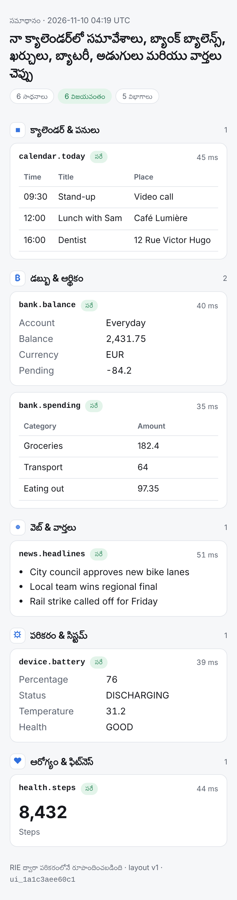

# Indian languages (Telugu first)

What the engine does for Telugu and other Indian languages, what was measured, and
what depends on the model you choose.

## 1. Tokenization: the model's tokenizer decides most of the cost

A tokenizer trained mostly on English splits Telugu into many small pieces. Every extra
token costs context space, prompt time and one forward pass when generating.
`rie tokstats` measures it for any GGUF, including vocabulary-only files:

```bash
rie tokstats model.gguf examples/text/telugu.txt examples/text/english.txt
```

The same seven sentences in Telugu and English, measured with llama.cpp's reference
vocabularies (`cargo test -p rie-core --test indic`):

| Tokenizer | Telugu tokens/word | English tokens/word | Telugu cost |
|---|---|---|---|
| Qwen2 / Qwen2.5 | 10.70 | 1.23 | 8.7× |
| Llama 3 (BPE) | 12.49 | 1.23 | 10.1× |
| Command-R (256k vocab) | 12.06 | 1.27 | 9.5× |
| Llama 2 / Phi-3 (SentencePiece) | 18.57 | 1.45 | 12.8× |
| GPT-2 | 19.64 | 1.32 | 14.8× |

For comparison, Sarvam reports **1.4–2.1 tokens per word** across ten Indian languages
for the 68k-vocabulary tokenizer of
[Sarvam-1](https://huggingface.co/sarvamai/sarvam-1) ([blog](https://sarvam.ai/blogs/sarvam-1)).
That is 5–8× fewer tokens than the tokenizers above. On a phone it is the biggest single
lever for Telugu: a 5× shorter sequence makes prompts 5× faster, lets 5× more
conversation fit in the same KV memory, and makes replies arrive several times sooner.

**What this means in practice**

* Pick the model by measuring with `rie tokstats` on your own Telugu text.
* Sarvam-1 is a 2B Llama-architecture model, which RIE runs. Its GGUF was not available
  in this environment, so it is **not yet tested here**. Measure it before relying on it.
* A model's tokenizer cannot be swapped after training. Sarvam got its fertility by
  training the tokenizer and the model together. Extending a vocabulary means
  fine-tuning; that is training, not inference, and is outside this engine.

**What the engine does itself**

* **NFC normalization before tokenizing.** Text from PDFs, OCR or some keyboards
  arrives decomposed (for example ై as U+0C46 U+0C56). Models never saw that form, and
  it costs extra tokens. Measured: 34 vs 32 tokens for one phrase before the fix,
  identical after. All eight reference tokenizers still pass llama.cpp's conformance
  outputs.
* **Exact round-trip.** decode(encode(text)) == text for Telugu on all eight
  vocabularies (SentencePiece models used to gain a leading space; fixed).
* **Streaming never shows a broken letter.** A Telugu letter is 3 bytes, and tokens
  often split it. Bytes are held until the letter is complete (tested token by token).

## 2. Tool calls, memory and tool selection in Telugu

* **Constrained tool calls are always valid UTF-8.** Before this release the JSON
  grammar could close a string in the middle of a Telugu letter, or accept overlong or
  surrogate byte sequences. Both produced broken characters in tool arguments; the
  regression test fails on the old code. The string cap now counts characters, not
  bytes, so Telugu gets the same room as English.
* **Indic-aware word splitting** (`rie_core::text`). Rust's `is_alphanumeric` is false
  for the virama (్ / ्), the nukta and ZWNJ, so "క్షేత్రస్థాయిలో" used to split into
  four fragments. This affected memory recall, tool selection and categorization; it is
  fixed in all three.
* **Cross-lingual tool selection.** Tools are usually described in English. A built-in
  phone-domain lexicon (`crates/rie-core/src/lexicon_indic.tsv`: Telugu and Hindi stems
  mapped to English concepts) matches by prefix, so agglutinated forms work:
  వాతావరణం, వాతావరణాన్ని and క్యాలెండర్‌లో all match. Code-mixed questions work too
  ("నా bank బ్యాలెన్స్"). Tools can add their own words in any language through
  `"keywords": [...]` in the manifest.
* **Memory recall** matches inflected Telugu (అమ్మ పుట్టినరోజు ↔ అమ్మ పుట్టినరోజుకు)
  through character trigrams over whole Indic words.

## 3. Answer pages in Telugu

`/v1/ask` detects the question's script, counted by words, so a code-mixed question is
still Telugu. An explicit `"lang"` overrides it.

* **Same layout, local labels:** category titles, status badges, chips, empty state,
  "Show all" and the footer.
* **Indian digit grouping** (2,50,000, 12,34,567).
* `<html lang="te">` and Noto Indic font fallbacks.

Telugu and Hindi labels are included. Bengali, Tamil, Kannada, Malayalam, Marathi,
Gujarati, Punjabi and Odia pages get Indian digit grouping with English labels until
someone adds label tables (one struct each in `crates/rie-server/src/ui.rs`).



## 4. Speech (TTS)

Sarvam's TTS documentation (Bulbul) describes a text-normalization stage before audio.
It reads numbers, currency, dates and Indian formats in words; for example "Rs.
1,00,000" becomes "one lakh rupees". RIE does this on the device, before any voice:

* `rie_core::speech::verbalize(text, "te")` handles:
  * whole numbers in the Indian system (వెయ్యి, లక్ష, కోటి);
  * decimals and negatives;
  * ₹ / Rs / INR with paise, plus $ and €;
  * percentages, HH:MM times and °C.
  Hindi is supported too. Identifiers like Q4_0 or A17 are left alone. Examples:
  * ₹2,431.75 → రెండు వేల నాలుగు వందల ముప్పై ఒకటి రూపాయలు డెబ్బై ఐదు పైసలు
  * 18:30 → పద్దెనిమిది గంటల ముప్పై నిమిషాలు
  * 60% → అరవై శాతం
* `sentences()` splits text into speakable chunks at । ॥ . ? ! and line breaks.
  Speaking starts after the first sentence, while the model is still generating
  (`"speak": true` on `/v1/chat/completions`).
* Every `/v1/ask` page comes with a spoken summary in its language (`"speech"`), in the
  same structure each time: the category, then the first facts per tool.

**Engines** (`rie-server --tts …`):

| Engine | How | Notes |
|---|---|---|
| Android system TTS | `--tts termux` (Termux:API `termux-tts-speak`) | uses the phone's installed voices; Google's speech services offer Telugu and Hindi |
| Any local engine | `--tts 'cmd:PROG ARGS'` with `{text} {lang} {voice} {out}` | with `{out}` it returns WAV (`/v1/audio/speech`, `/ui/ID.wav`); without it, the engine plays |
| An app's own TTS | `POST /v1/speech/prepare` | returns verbalized text and sentences for Android `TextToSpeech` or iOS `AVSpeechSynthesizer`; needs no server engine |

Open Telugu voice models you can plug in with `cmd:` (check each license yourself):

* **[facebook/mms-tts-tel](https://huggingface.co/facebook/mms-tts-tel):** VITS, small
  enough for phones; runs through sherpa-onnx / Piper-style runtimes. License
  CC-BY-NC-4.0 (non-commercial).
* **[AI4Bharat IndicF5](https://aikosh.indiaai.gov.in/home/models/details/aibharat_indicf5.html):**
  covers 11 Indian languages including Telugu. Listed as MIT, but it is a large
  flow-matching model, heavy for phones.
* **Indic Parler-TTS (AI4Bharat):** includes Telugu. Sources disagree on its license
  (MIT vs Apache-2.0) and the weights are gated, so verify before use.
* Sarvam's Bulbul is a cloud API, not an on-device model.

Running a TTS network natively inside RIE (a VITS or flow-matching decoder in Rust) is
not done yet. Today speech goes through the engines above.

## 5. Tested

* `cargo test -p rie-core --lib text speech constrain`:
  * word splitting and script detection (including code-mixed text);
  * NFC and the lexicon;
  * Telugu and Hindi numbers, money, percentages, times and temperatures;
  * sentence splitting and UTF-8-safe strings at the cap (overlong forms and
    surrogates rejected).
* `RIE_VOCAB_DIR=… cargo test -p rie-core --test indic`: round-trip, NFC/NFD and
  streaming with 8 real tokenizers.
* `cargo test -p rie-server --test indic`:
  * a Telugu question gives a Telugu page and speech;
  * inflected and code-mixed Telugu fans out to 6 tools;
  * Hindi pages;
  * `/v1/speech/prepare`, `/v1/audio/speech` (one engine call per sentence, joined
    into one WAV) and spoken `/v1/ask` pages;
  * chat spoken while streaming;
  * Telugu tool arguments valid UTF-8 over 6 seeds;
  * Telugu memory recall.
* All of the above also pass on ARM64 (QEMU). The ARM run found two bugs that x86
  missed: overlong byte sequences, and NUL characters reaching the TTS engine.

The Telugu and Hindi word tables (numbers, labels, lexicon) follow standard usage but
were not reviewed by native speakers. They are plain data and easy to correct.
